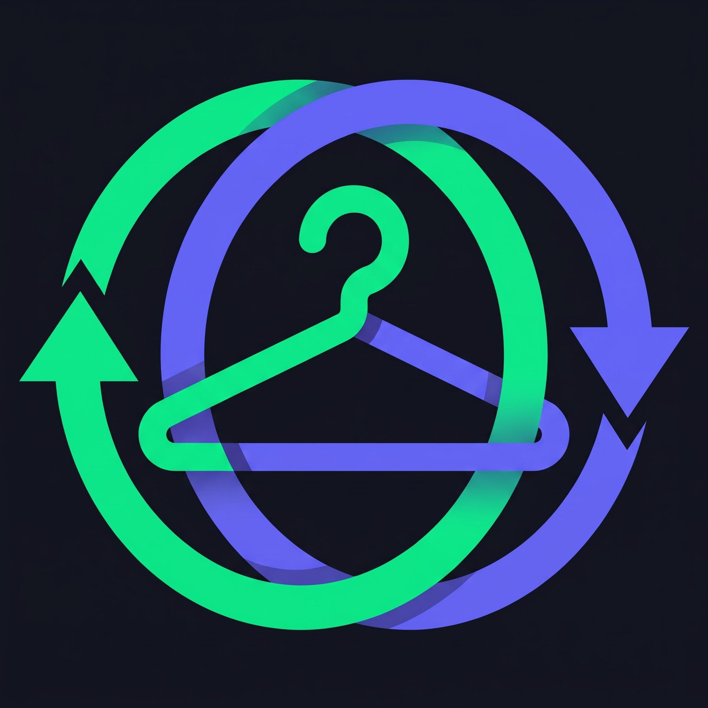

<p>
  
</p>

# LookBook (Swap Studio)

LookBook is a full-stack web application and administrative management console for peer-to-peer clothing swaps and inventory control. Built with a modern React frontend and a robust Node.js/Express REST API backed by MySQL (Aiven Cloud or local), it features transactional swap management, dynamic photo handling, cascading data cleanup, and strict input validation.

---

## 🚀 Tech Stack

- **Frontend:** React, Vite, Tailwind CSS
- **Backend:** Node.js, Express.js
- **Database:** MySQL (`mysql2` with connection pooling, transaction isolation, and dynamic SSL for Aiven Cloud)
- **Validation & Security:** Regex input sanitization, parameterized SQL statements, fail-safe environment configuration
- **Testing & Quality:** Vitest (Frontend), Mocha / Vitest (Backend)

---

## 🛠️ Project Structure

```text
lookbook-api/
├── backend/
│   ├── config/          # Database configuration plus initialization (db.js, init-db.js)
│   ├── db/              # SQL schema and seeds (schema.sql, seeds.sql)
│   ├── routes/          # Express API routes (users.js, products.js, swap_orders.js)
│   ├── .env.example     # Backend environment template
│   └── server.js        # Entry point
├── docs/                # Project overview, TODO list, and project archive documentation
├── frontend/
│   ├── src/
│   │   ├── api/         # Centralized API service methods & HTTP requests
│   │   ├── assets/      # Static visual resources, icons, and media
│   │   ├── components/  # Modular & reusable React UI components
│   │   ├── hooks/       # Custom React hooks for business logic & state
│   │   ├── App.jsx      # Main application router/layout entry point
│   │   ├── main.jsx     # Vite React DOM root renderer
│   │   └── index.css    # Global styles & Tailwind CSS imports
│   ├── index.html       # Single-Page Application entry point HTML
│   ├── postcss.config.js# PostCSS plugin configuration
│   ├── tailwind.config.js# Tailwind CSS framework settings
│   └── vite.config.js   # Vite bundler & Vitest test runner setup
├── .gitignore           # Git untracked path rules
└── README.md            # Main repository documentation & setup guide
```

---

## 🏁 Quick Start

### 1. Requirements

- Node.js (v18+ recommended)
- MySQL (local instance or Aiven Cloud MySQL URI)

### 2. Environment Configuration

Navigate to the `backend/` directory and copy `.env.example` to `.env`:

```bash
cd backend
cp .env.example .env
```

Configure your backend variables in `.env`:

```env
PORT=3000
NODE_ENV=development

# Aiven Cloud MySQL (Default)
DB_HOST=your_aiven_host
DB_PORT=your_aiven_port
DB_USER=your_aiven_user
DB_PASSWORD=your_aiven_password
DB_NAME=defaultdb
```

### 3. Backend Setup & Database Initialization

```bash
# Install dependencies
cd backend
npm install

# Initialize schema and seed data
npm run init-db

# Start development server
npm run dev
```

The Express API will start on **http://localhost:3000**.

### 4. Frontend Setup

```bash
cd ../frontend
npm install
npm run dev
```

The React + Vite application will start on **http://localhost:5173**.

---

## 🔌 API Endpoints

### 👤 Users (`/api/users`)

| Method | Endpoint | Description |
|----------|----------|----------|
| GET | `/api/users` | Get all users |
| GET | `/api/users/:id` | Get user details and listed products |
| POST | `/api/users` | Register a new user (validates name, surname, unique email) |
| PUT | `/api/users/:id` | Update user details |
| DELETE | `/api/users/:id` | Cascading delete user (cancels active swaps and restores item statuses) |

### 🧥 Products (`/api/products`)

| Method | Endpoint | Description |
|----------|----------|----------|
| GET | `/api/products` | List all products with owners and photos |
| POST | `/api/products` | Create a new item listing |
| PUT | `/api/products/:id` | Update item details (blocked if status is `swapped`) |
| DELETE | `/api/products/:id` | Remove product (blocked if involved in an active swap) |

### 🔁 Swap Orders (`/api/swaps`)

| Method | Endpoint | Description |
|----------|----------|----------|
| GET | `/api/swaps` | Fetch swap orders (supports filters: `date`, `startDate`, `endDate`, `productId`) |
| POST | `/api/swaps` | Create atomic 2-user, 2-product swap (updates statuses to `swapped`) |
| PUT | `/api/swaps/:id` | Update users or items involved in a swap |
| DELETE | `/api/swaps/:id` | Delete swap order and restore item statuses to `available` |

---

## 🧪 Testing & Security Audits

Run backend and frontend test suites and dependency security audits:

### Backend

```bash
cd backend
npm test
npm audit
```

### Frontend

```bash
cd ../frontend
npm test
npm audit
```

---

## ✅ Core Features

- Administrative inventory management
- Peer-to-peer clothing exchange platform
- Transactional swap processing
- Automatic status synchronization
- Cascading user and product cleanup
- Secure REST API design
- MySQL connection pooling with Aiven Cloud support
- Input validation and sanitization
- Automated testing and dependency auditing
